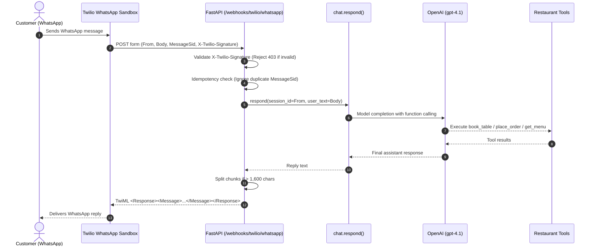

# Twilio WhatsApp Webhook Endpoint

This document describes the Twilio WhatsApp webhook endpoint implemented in [`app.py`](../app.py) and the underlying conversational engine in [`chat.py`](../chat.py).

---

## 1. Overview

Twilio sends incoming WhatsApp messages to your configured webhook URL as an HTTP `POST` request with `Content-Type: application/x-www-form-urlencoded`.

- **Endpoint Route**: `POST /webhooks/twilio/whatsapp`
- **Info Route**: `GET /webhooks/twilio/whatsapp`
- **Output Format**: TwiML XML (`application/xml`)



---

## 2. Key Features

### 1. Request Signature Verification
- Incoming requests must supply a valid `X-Twilio-Signature` HTTP header.
- Verification is performed using Twilio's official `RequestValidator` with `TWILIO_AUTH_TOKEN`.
- If the signature is missing or fails verification, the request is rejected immediately with **`403 Forbidden`**.
- Handles reverse-proxy headers (`x-forwarded-proto`, `x-forwarded-host`) when running behind ngrok, Cloudflare, or Traefik on Coolify.
- An optional `TWILIO_WEBHOOK_URL` can be specified to pin the exact external signature target URL.

### 2. Idempotency & Duplicate Protection
- Twilio automatically retries webhooks if acknowledgment is delayed.
- Every `MessageSid` is cached with a 1-hour TTL.
- If a duplicate `MessageSid` arrives, the server immediately returns an empty `<Response/>` with HTTP `200 OK` without triggering duplicate agent or tool invocations.

### 3. Automatic Message Chunking (> 1,600 Chars)
- WhatsApp limits individual messages to 1,600 characters.
- Replies longer than 1,500 characters are automatically split along paragraph boundaries (`\n\n`), newlines (`\n`), sentence ends (`. `), or whitespace into multiple sequential `<Message>` elements inside the single TwiML response.

### 4. Empty & Media-Only Messages
- If an incoming message contains no text body:
  - **Media-only message (`NumMedia > 0`)**: Responds with a polite notification that only text messages are currently supported.
  - **Empty text**: Responds with a friendly welcome prompt guiding the customer.

### 5. Session Continuity per Phone Number
- The customer's WhatsApp phone number (`From`, e.g. `whatsapp:+447123456789`) is used as the unique `session_id`.
- Conversation turns are tracked across the session, allowing natural multi-turn flows (e.g. asking for party size, changing mind, selecting menu items).

---

## 3. Required Environment Variables

Set the following in `.env` (or in Coolify dashboard for deployed environments):

```env
# Twilio WhatsApp Credentials
TWILIO_ACCOUNT_SID=AC...
TWILIO_AUTH_TOKEN=your_auth_token_here
TWILIO_WHATSAPP_NUMBER=whatsapp:+14155238886

# Optional: override webhook URL for signature validation behind tunnels
# TWILIO_WEBHOOK_URL=https://your-ngrok-id.ngrok-free.app/webhooks/twilio/whatsapp
```

---

## 4. Local Testing with ngrok and Twilio Sandbox

### Step 1: Start the Local FastAPI App
```bash
uvicorn app:app --port 8000 --reload
```

### Step 2: Start an ngrok Tunnel
In a separate terminal:
```bash
ngrok http 8000
```
Note the HTTPS forwarding URL (e.g. `https://abcd-1234.ngrok-free.app`).

### Step 3: Configure Twilio WhatsApp Sandbox
1. Open the [Twilio Console](https://console.twilio.com/) > **Messaging** > **Try it out** > **Send a WhatsApp message**.
2. Under **Sandbox Settings**:
   - Set **"WHEN A MESSAGE COMES IN"** to:
     `https://<your-ngrok-url>/webhooks/twilio/whatsapp`
   - Set the HTTP method to **`HTTP POST`**.
3. Save settings.

### Step 4: Opt In & Test from WhatsApp
1. Send the sandbox join keyword (e.g., `join <word>`) from your personal WhatsApp to Twilio's shared sandbox number (`+1 415 523 8886`).
2. Once connected, send messages such as:
   - *"Hi, can I book a table for 2 tomorrow at 7pm? Name is Alex, 07123456789"*
   - *"What starters are on the menu?"*
   - *"I'd like to order a chicken burger for pickup"*

---

## 5. Automated Tests

Run the dedicated webhook unit and integration test suite:

```bash
.venv/bin/python -m unittest tests/test_twilio_webhook.py
```

Tests cover:
- HTTP 403 rejection of missing/forged signatures.
- Valid signature processing and TwiML formatting.
- Duplicate `MessageSid` idempotency.
- Media-only and empty message handling.
- Long message splitting into multiple `<Message>` chunks.
- Per-phone-number session continuity.
- End-to-end tool-calling execution with the live model.
